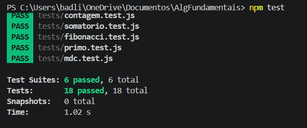

# Algoritmos Fundamentais

Implementação de algoritmos clássicos em Java e JavaScript.

## Estrutura

```
AlgFundamentais/
├── .vscode/
│   └── launch.json
├── Java/
│   ├── Main.java
│   ├── Primo.java
│   ├── Somatorio.java
│   ├── Fibonacci.java
│   ├── Mdc.java
│   ├── Quicksort.java
│   └── Contagem.java
├── JavaScript/
│   ├── primo.js
│   ├── somatorio.js
│   ├── fibonacci.js
│   ├── mdc.js
│   ├── quicksort.js
│   └── contagem.js
├── web/
│   └── index.html
├── tests/
│   └── *.test.js
├── package.json
├── package-lock.json
└── README.md
```

| Algoritmo | Java | JavaScript |
|---|---|---|
| Número primo | `Java/Primo.java` | `JavaScript/primo.js` |
| Somatório | `Java/Somatorio.java` | `JavaScript/somatorio.js` |
| Fibonacci | `Java/Fibonacci.java` | `JavaScript/fibonacci.js` |
| Máximo divisor comum | `Java/Mdc.java` | `JavaScript/mdc.js` |
| Ordenação (Quicksort) | `Java/Quicksort.java` | `JavaScript/quicksort.js` |
| Contagem | `Java/Contagem.java` | `JavaScript/contagem.js` |

Em todos os arquivos a lógica do algoritmo fica em uma função separada da entrada e da saída, para que possa ser testada ou reaproveitada isoladamente.

## Como executar

### Java

Requer JDK instalado.

```bash
cd Java
javac Primo.java
java Primo
```

Para executar todos os algoritmos de uma vez:

```bash
cd Java
javac *.java
java Main
```

Do JDK 11 em diante também é possível rodar um arquivo único sem compilar antes:

```bash
java Primo.java
```

### JavaScript

Requer Node.js instalado.

```bash
cd JavaScript
node primo.js
```

## Testes automatizados (entregável 4)

Requer Node.js e npm. Na pasta principal do repositório, execute:

```bash
npm install
npm test
```

O comando executa Jest. Há um arquivo em `tests/` para cada um dos seis algoritmos em `JavaScript/`, com três testes por algoritmo (18 no total). Os testes conferem resultados usuais, casos de borda e entradas inválidas. As funções são exportadas para que possam ser importadas pelos testes. Os exemplos continuam disponíveis com `node JavaScript/primo.js` e os demais arquivos.

As funções validam os tipos de entrada e lançam erros para dados inválidos: listas devem conter números finitos; primo e MDC exigem inteiros seguros; Fibonacci aceita posições inteiras entre 0 e 78; MDC(0, 0) é indefinido. O Quicksort ordena a própria lista recebida e também a devolve.

Os testes automatizados cobrem as implementações em JavaScript. Os arquivos Java e a interface web permanecem disponíveis, mas não integram a suíte Jest.

### Evidência da execução

O print abaixo mostra a execução de `npm test`, com 6 conjuntos e 18 testes aprovados:



## Valores de teste

Os valores de entrada estão definidos em constantes no início de cada arquivo. Para testar outros casos, basta alterá-los.

| Programa | Entrada | Saída esperada |
|---|---|---|
| Primo | `9` | não é primo |
| Somatório | `[1, 2, 3, 4, 5]` | 15 |
| Fibonacci | `8` | 21 |
| MDC | `48, 18` | 6 |
| Quicksort | `[5, 3, 8, 1, 9, 2, 7]` | `[1, 2, 3, 5, 7, 8, 9]` |
| Contagem | `[1, 2.5, 3, 4.7, 5]` | 3 |

## Interface web

O arquivo `web/index.html` é uma página estática que executa os seis algoritmos diretamente no navegador. Para cada algoritmo, a página recebe a entrada, mostra o resultado e exibe o passo a passo percorrido até chegar a ele. Basta abrir o arquivo no navegador; não é necessário servidor nem instalação de dependências.

Versão publicada: https://vscaueh.github.io/AlgFundamentais/

## Vídeo de depuração

Disponível em: https://share.vidyard.com/watch/NqDTxpjj4x1tKVERjj2Ld7

## Descrição dos algoritmos

### Número primo

Um inteiro positivo `n` é primo quando só é divisível por 1 e por `n`. A verificação testa divisores de 2 até a raiz quadrada de `n`: qualquer divisor maior que a raiz teria um par correspondente menor, que já teria sido encontrado antes. Isso reduz o número de iterações sem alterar o resultado.

### Somatório

Percorre o conjunto acumulando os valores em uma única variável, inicializada em zero.

### Fibonacci

Cada termo, a partir do terceiro, é a soma dos dois anteriores, sendo `F(0) = 0` e `F(1) = 1`. A implementação é iterativa e guarda apenas os dois últimos termos, evitando o custo exponencial da versão recursiva ingênua. Em Java o retorno é `long`, porque `int` estoura a partir do termo 47.

### Máximo divisor comum

Algoritmo de Euclides: `mdc(a, b) = mdc(b, a % b)`, repetido até o resto chegar a zero. O último valor não nulo é o resultado.

### Ordenação com Quicksort

Escolhe o último elemento como pivô e particiona o array de modo que os menores ou iguais fiquem à esquerda e os maiores à direita. Em seguida repete o processo recursivamente nas duas metades, até que cada trecho tenha um único elemento.

### Contagem

Percorre o conjunto do primeiro dado ao N-ésimo, ambos inclusive, incrementando um contador a cada valor que seja inteiro. Em JavaScript a verificação usa `Number.isInteger()`; em Java, a comparação do valor com o próprio piso.

## Observações de implementação

- A troca de elementos no Quicksort usa variável temporária em Java e desestruturação de array em JavaScript, já que Java não possui essa sintaxe.
- Em Java, o nome da classe pública corresponde ao nome do arquivo, conforme exigido pela linguagem.
- Os métodos são declarados como `static` para permitir chamada direta a partir do `main`, sem instanciar objetos.
